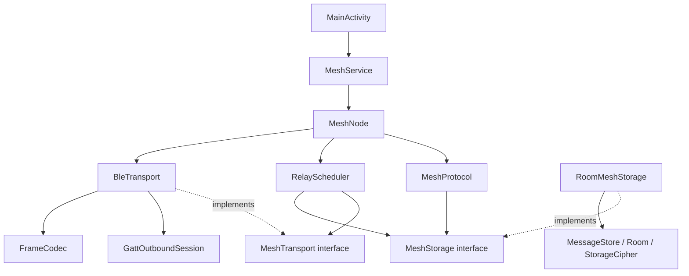

# Mesh component architecture

## Ownership

| Component | Owns | Does not own |
| --- | --- | --- |
| `MeshService` | Foreground notification, Android lifecycle, binding and existing UI API | Radio callbacks, relay policy, packet acceptance, Room queries |
| `MeshNode` | Worker orchestration, recovery, maintenance, announcements and component events | GATT implementation, cryptographic primitives, SQL |
| `MeshTransport` | Byte-oriented transport and send-callback contract | Message types or delivery receipts |
| `BleTransport` | BLE discovery/advertising, GATT server, radio receiver, native resource lifetime | Conversation state, TTL policy, delivery confirmation |
| `GattOutboundSession` | One client connection, MTU negotiation, service discovery, framed writes and close deadlines | Peer selection, retries across sessions, database mutations |
| `FrameCodec` | Packet fragmentation/reassembly, per-peer buffers, size/capacity/deadline rules | JSON, UTF-8 text decoding, signatures, Android |
| `RelayScheduler` | Peer table, signal ordering, freshness, backoff, batches, concurrency, pending cache and forwarding eligibility | Native Bluetooth objects, Handler, UI or Room DAO |
| `MeshProtocol` | Outgoing preparation; incoming parse/authentication/replay decisions; decryption, ACKs, local delivery and relay TTL | BLE frames, peer selection, Android lifecycle |
| `MeshStorage` / `RoomMeshStorage` | Persistence use cases and encrypted record adaptation | Routing or Bluetooth |
| `MessageStore` / Room / `StorageCipher` | Atomic history/outbox/replay/status transactions, encrypted fields and schema migrations | Transport or service state |

`MeshService` remains `com.example.offgrid.MeshService`; its source now matches that
package instead of living in a misleading `mesh/` filesystem directory. Manifest
registration, binders, send statuses, service actions and advertised UUIDs stay
compatible. The packet version and Room schema are unchanged by this extraction.
`MeshConfig` centralizes the radio UUIDs and shared maintenance/queue timing.

## Thread contract

The service creates one `offgrid-mesh` HandlerThread. Node lifecycle commands,
transport listener callbacks, protocol acceptance, relay mutation and mesh storage
operations run there. BLE platform callbacks marshal onto that worker. GATT write
admission applies the synchronized frame budget before cloning/posting bytes.
`FrameCodec` and relay state are confined to that worker and need no locks.

Preparing an outgoing message may run on the caller's thread, as before; the
service posts its persistence/queue work. The immediate result is ACCEPTED, not
persisted or Delivered. UI events/notifications are marshalled to the main thread.
The existing history executor and Room observation remain separate from the mesh
worker and are owned by `MessageStore`/the activity.

`RelayScheduler.Timer` injects monotonic/wall clocks and scheduling. Its packet
encoder is injected separately, so JVM scheduling tests need neither Android JSON
nor a real radio. A fake `MeshTransport` implements the same callback contract as
BLE, including session completion and pre-send cancellation checks.

## Acceptance and recovery

1. BLE reassembles bytes through `FrameCodec` before decoding any JSON/text.
2. `MeshProtocol` applies packet budgets, parsing, signed namespace/time/identity
   checks and sender budgets. It checks the durable clock/replay state before any
   delivery or relay mutation.
3. The protocol calls a storage use case that commits the packet's replay record,
   history and pending relay packet in one transaction. A private recipient saves
   the message and its ACK outbox entry atomically.
4. Only after the transaction succeeds does the node notify listeners and load
   the persisted pending packet into the relay scheduler.
5. An authenticated ACK confirms the exact saved outgoing packet and atomically
   records replay evidence, marks Delivered and deletes that pending packet. The
   scheduler removes its in-memory copy and skips canceled packets still present
   in session batch snapshots.

On start, recovery expires old records, authenticates saved packets and restores
only eligible records with the original remaining lifetime and forward count.
An unreadable encrypted record fails recovery without deleting the original data.
Legacy/invalid pending packets are explicitly rejected as before. Bluetooth loss
pauses routing and clears peer/native connection state, retaining durable pending
messages for recovery. Service destruction closes active **and delayed-closing**
GATT sessions before the worker thread exits.

## Validation boundaries

- `FrameCodecTest`: byte round trips, MTU boundaries, UTF-8 split boundaries,
  malformed/oversized frames, interleaved peers, transfer limits and deadlines.
- `RelaySchedulerTest`: fake clock/radio ordering, slot/batch/fan-out eligibility,
  backoff, stale peers, deadline recovery, queue eviction and stale callbacks.
- `MeshProtocolIntegrationTest`: production protocol + encrypted Room storage
  across three logical nodes, TTL, duplicate/restart behavior, authenticated
  receipts, malformed/tampered input and transaction failure.
- Existing crypto, replay, QR trust, storage and migration tests stay in place.

The logical-node tests bypass Bluetooth: they cannot validate actual discovery,
GATT vendor behavior, radio interference, physical range or manufacturer battery
restrictions. Record physical results using TESTING.md before updating README's
physical-device status.

## Changes made while extracting

The wire framing is unchanged, but fragmentation now caps characteristic values
at 512 bytes even when Android negotiates MTU 517. The previous MTU-only calculation
could produce 514-byte values that the receiver rejected. Tests cover the cap.
Malformed frames discard their peer's partial assembly, rather than leaving it
available for later continuations. Delayed GATT closes are tracked through teardown,
preventing stop from abandoning a handle that was already removed from an active
session map. These are bounded transport fixes, not evidence of device testing.
