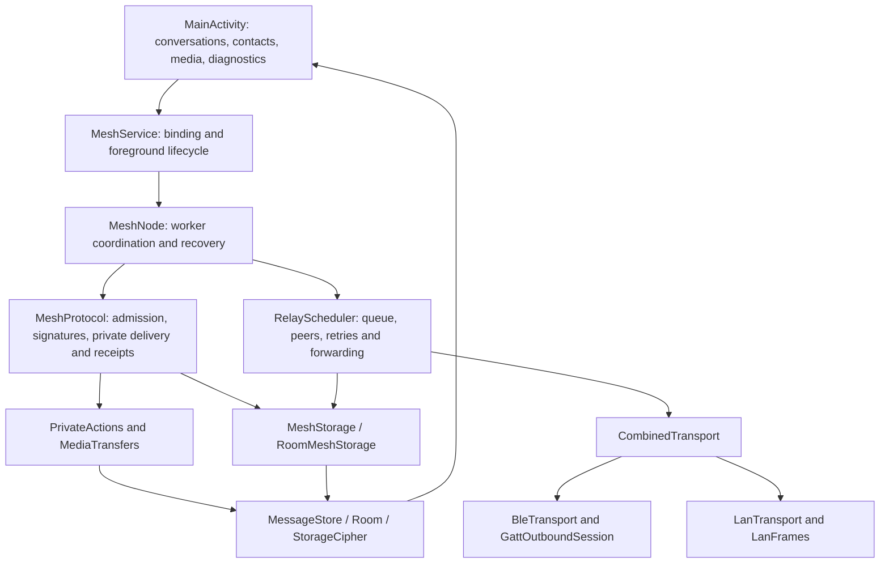

# OffGrid repository review report

Prepared: 16 November 2026 (UTC). Intended audience: Claude or a human technical reviewer.

This report describes implemented code, recorded validation, known limitations and
proposals. It is not an independent security audit or evidence of physical mesh
reliability. Proposed work is explicitly separated from completed work.

## 1. Repository and reviewed baseline

| Item | Current state |
| --- | --- |
| Repository | <https://github.com/mittalsukhansh/OffGrid> |
| Development baseline | `main` |
| Application source snapshot | [`968000ca9d82b82b768ba6a30854cc624d238fa2`](https://github.com/mittalsukhansh/OffGrid/tree/968000ca9d82b82b768ba6a30854cc624d238fa2) |
| Source app version | `0.3-dev`, Android version code `4` |
| Live packet protocol | Version `4` |
| Room database schema | Version `4`, with explicit migrations from 1 through 4 |
| Published test releases | `v0.1` and [`v0.2`](https://github.com/mittalsukhansh/OffGrid/releases/tag/v0.2) |
| v0.2 source snapshot | `2ec43f6f1fabbecda0360ce267c4d099cc514f21` |
| Latest application-baseline CI | [Successful main run](https://github.com/mittalsukhansh/OffGrid/actions/runs/43829937343) |
| Tested development APK | [0.3-dev APK artifact, ZIP; GitHub sign-in may be required](https://github.com/mittalsukhansh/OffGrid/actions/runs/43829522562/artifacts/14207667680) |

The published v0.2 APK does **not** contain the later conversations, local Wi-Fi or
network diagnostics additions. The development APK does. Documentation commits
may appear after the application snapshot above without changing its code.

The project started from `vikramaditya19/OffGrid`; that repository remains an
upstream remote. Historical commits retain their original authorship. The current
GitHub repository is not marked as a GitHub fork. Current work is pushed through
`mittalsukhansh`; earlier authorship should not be rewritten or mistaken for the
account used for new pushes. Fully merged development branches were removed.

## 2. About the project

OffGrid is an Android prototype for nearby, offline messaging. Devices exchange
signed packets directly over Bluetooth Low Energy (BLE)/GATT or an optional local
Wi-Fi connection. Devices also retain eligible packets and attempt onward relay.
It is a custom store-and-forward protocol, not the Bluetooth SIG Mesh standard.

The intended use is communication where internet or cellular access is unavailable,
including nearby teams and outdoor activities. Actual range, reliability, battery
use, throughput and emergency suitability have not been established on physical
phones. It must not yet be presented as a dependable emergency communications system.

Core product decisions:

- No hosted VM, messaging backend, SMS service or phone-number account is required.
- Contacts are public-key identities. QR codes or contact strings exchange keys;
  full fingerprint comparison establishes the user's verification decision.
- Nicknames are local labels, not globally reserved usernames. Duplicate nicknames
  do not merge contacts or let one identity claim another identity's messages.
- Private messages are encrypted end to end; public messages are readable but signed.
- Queuing, forwarding and confirmed delivery are different states.
- Disconnected devices can lose delivery opportunities. There is no global server
  inbox, guaranteed route, remote wake-up service or guaranteed recall mechanism.

## 3. Technology used

Versions below are from the repository configuration, not an assessment that each
dependency is the newest available or free of vulnerabilities.

| Area | Implementation |
| --- | --- |
| Application language | Java; Java 11 source/target compatibility |
| Build configuration | Gradle Kotlin DSL and version catalog |
| Build tooling | Gradle `9.6.0`, Android Gradle Plugin `9.4.1`, JDK `25` |
| Android platform | Minimum API `26` / Android 8; compile and target API `37`; CI installs `android-37.0` and Build Tools `36.0.0` |
| UI | XML layouts, AppCompat `1.6.1`, Material `1.10.0`, RecyclerView/ListView, AndroidX Activity/Lifecycle, ViewModel and LiveData |
| Persistence | Room `2.8.4` over SQLite, schema export and explicit migrations |
| Local encryption | AES-256-GCM with Android Keystore-backed symmetric storage/wrapping keys |
| Network cryptography | P-256 ECDH, HKDF-HMAC-SHA-256, AES-256-GCM; SHA256withECDSA packet signatures |
| BLE | Android scanning/advertising, GATT server/client, MTU-aware fragmentation/reassembly |
| Local Wi-Fi | ConnectivityManager, network-bound IPv4 TCP sockets, Android NSD/DNS-SD discovery |
| QR exchange | ZXing embedded `4.3.0`, ZXing core `3.5.3` |
| Attachments | Android bitmap/JPEG APIs, MediaMetadataRetriever, SHA-256 integrity, scoped FileProvider access |
| Concurrency | HandlerThread mesh worker, executors, bounded socket IO threads, main-thread UI callbacks |
| Tests | JUnit `4.13.2`, AndroidX instrumentation, Room migration tests, Espresso `3.5.1` |
| Automation | GitHub Actions for build/lint/JVM tests, API 30 emulator tests and test release publication |

There is no iOS implementation, web client, Firebase backend or hosted directory.
The app requests legacy Android location permission for BLE scanning on older
Android versions; that does not mean SOS/location sharing has been implemented.

## 4. What is implemented

| Capability | Implemented behavior | Important boundary |
| --- | --- | --- |
| Public chat | Signed public broadcasts and relay | Content is plaintext; no guarantee that everyone receives it |
| Private chat | Key-addressed encrypted messages with authenticated receipts | Static ECDH, without forward secrecy |
| Persistence | Encrypted message bodies, durable relay queues, delivery state and replay evidence | Queryable metadata remains visible in SQLite; this is not whole-database encryption |
| Delivery states | Queued, Forwarded, Delivered and timeout/failure outcomes | Delivered means an authenticated recipient receipt, not that a human read it |
| Contact exchange | QR generation/scanning and manual contact strings | Import/scanning alone does not verify the person's identity |
| Contact verification | Full fingerprint comparison, persistent verified flag and indicators | Verification is pinned to a key-derived identity, not a nickname |
| Nicknames | Local contact labels and duplicate-name warning | No central uniqueness check or global username registration |
| Separate conversations | Public and per-contact histories, recent-activity ordering and unread counts | Selected history loads up to 500 latest entries; this is a display limit, not a retention policy |
| Chat usability | Per-chat drafts while switching/rotating, conversation back navigation | Draft text is not durably backed up across process loss |
| Notifications | Generic new-message notices linking to the appropriate conversation | Android permission/background rules apply; notifications omit bodies and nicknames |
| Private unsend | Author-bound encrypted request, target acknowledgement, durable tombstone, retries | Best effort; offline recipients, screenshots, exports and forensic remnants are outside its guarantee |
| Photos | JPEG resizing/compression, previews, encrypted resumable transfer | Up to 48 KiB; sender resizes to at most 768 pixels per side |
| Short videos | Validated MP4 transfer and explicit external playback | Up to 256 KiB and 10 seconds; no built-in video transcoding |
| Attachment integrity | Persisted chunk state, receiver bitmaps, SHA-256/length/format checks | Delivered is withheld until complete validation and encrypted save |
| Security admission | Signed identity binding, timestamp rules, durable replay ledger, bounded flood budgets | Not Sybil resistance, anonymous transport, a security audit or a jamming defense |
| BLE relay | Scanning, advertising, fragmentation, bounded forwarding, retries and recovery | Physical multi-hop operation remains unverified |
| Local Wi-Fi | Opt-in same-network IPv4 discovery and TCP transport alongside BLE | No Wi-Fi Direct, hotspot creation, IPv6-only support or guarantee for hotspot-host interfaces |
| Network diagnostics | BLE/Wi-Fi state, endpoints, queues, sessions, counters, recent errors and retry delays | Endpoints are discovered transport addresses, not verified people or proof of connectivity |
| Maintainability | Service lifecycle separated from transport, relay, protocol and persistence responsibilities | Some UI/feature classes remain large and deserve focused review |
| Build/distribution | CI checks, test APK artifacts, versioned prerelease workflow, checksums/signature assets | Current releases use debug signing; stable upgrade signing is not established |

### Current operational limits

- Text: at most 280 UTF-16 code units (`String.length`); private plaintext also has a UTF-8 byte cap.
- Complete wire packet: at most 2,048 bytes. GATT characteristic values: at most 512 bytes.
- Default chat hop budget: 7. Announcements start at 4; accepted TTL is at most 15.
- Relay cache: 200 packets, at most 3 outbound sessions and 20 packets per batch;
  each queued packet has a six-forward eligibility limit and a ten-minute deadline.
- Media: 640-byte chunks, four in flight, retry after 45 seconds; at most two new
  chunks per five-second pump, reduced to one when receiving an active transfer.
- Initial media offer window: ten minutes; accepted transfer lifetime: one hour.
- Media storage: at most two outgoing/four total active transfers, 64 retained
  attachments and approximately 16 MiB of encrypted file storage.
- LAN: up to three inbound sessions plus the relay's three outbound sessions;
  bounded discovery tables, five-second connect timeout, eight-second IO waits
  and a 25-second session deadline.

**Wi-Fi does not yet remove the media pacing bottleneck.** Two 640-byte chunks per
five seconds is an ideal payload preparation ceiling of 256 bytes/second, before
acknowledgements, discovery, retries, flood admission and transport overhead.
That implies about 3.2 minutes for 48 KiB or 17.1 minutes for 256 KiB even in an
idealized case. These are calculations from configured limits, not measured
throughput. Bidirectional receiving and interruptions can make it slower.

## 5. Architecture and data flow



The service owns a mesh HandlerThread. Protocol admission, relay state and mesh
persistence run on that worker. BLE callbacks marshal to it. LAN threads handle
bounded socket IO and wait for worker admission; they do not mutate routing or
Room state directly. UI updates return to the main thread. Room observation and
a separate history executor load the selected conversation.

A typical private send:

1. Validate the target and text, encrypt for that contact, and sign the envelope.
2. Save the encrypted display copy and outgoing packet before showing the queued message.
3. Discover eligible transport endpoints and attempt forwarding within queue limits.
4. The recipient validates the signature, identity namespace, timestamp, replay
   state and encryption before committing history plus a receipt outbox entry.
5. The sender accepts only an authenticated receipt bound to the exact original
   message before marking Delivered and removing its original pending packet.

For media, a manifest begins the conversation entry; completion requires all
chunks and file validation. A Wi-Fi transfer-confirmation byte or BLE successful
write advances forwarding only. Neither can establish Delivered.

Room schema 4 covers `messages`, `pending_messages`, `replay_ledger`,
`security_clock`, `withdrawals`, `media` and `media_parts`. Bodies, queued packets,
files and parts are encrypted fields. Conversation IDs, timestamps, statuses and
unread flags remain queryable metadata. Contact preferences also contain local
labels/trust metadata. Application-level deletion is not guaranteed secure erasure.

## 6. Validation: what is working versus what is unproven

The application snapshot has successful build and emulator jobs on `main`.
Local verification also completed APK assembly, lint and **38 JVM tests**.
Android instrumentation covers the production SQLite/Keystore/media APIs and UI;
logical mesh tests deliver packets between simulated nodes rather than real radios.

| Evidence | Coverage |
| --- | --- |
| JVM tests | Framing/fragmentation, TTL/namespace/time rules, flood budgets, receipts, nickname rules, relay scheduling, LAN framing/subnet gates and combined transport state/routing |
| Real TCP loopback test | Maximum LAN batch transfer and transfer confirmations, alongside malformed/oversized/truncated framing checks |
| Android persistence/security tests | Encrypted reload, replay/clock handling, receipt binding, trust/QR state and schema migrations |
| Android offline-sharing tests | Withdrawal authorization/tombstones/retries, resumption/reordering/duplicates, integrity failure, JPEG and MP4 bounds |
| Android conversation tests | Per-contact filtering, durable unread counts, selective reads and new-arrival races, incomplete media and migration defaults |
| Espresso UI test | Separate chat rendering/read behavior, rotation, back navigation and diagnostics opening |

Not established by those checks:

- Three physical phones with A and C outside direct BLE range and B relaying.
- NSD/multicast discovery and mixed-radio traffic across real access points/phones.
- Actual notification behavior across Android/OEM versions and permission choices.
- Screen-off delivery, battery optimization, movement, interference and reconnection reliability.
- Measured BLE/Wi-Fi throughput, large-peer scalability, energy use or success rates.
- Production signing/upgrade continuity, recovery after device loss, or an independent security review.

Passing emulator tests must not be presented as evidence that physical mesh
communication, Wi-Fi fallback or outdoor safety behavior has been validated.

## 7. Known limitations and review priorities

These are known design limits or review targets, not a claim that every item is an
exploitable defect. New findings must be verified against the source.

1. **Release continuity and recovery:** debug certificates can differ between
   builds, blocking an in-place update. Uninstalling deletes identity, history,
   contacts and keys. There is no user-facing encrypted backup/restore flow.
2. **Forward secrecy:** static ECDH remains. Compromise of a long-term private key
   may expose recorded past traffic. Signing and verification do not fix this.
3. **Identity-key handling:** the EC identity is software-generated and stored
   wrapped by an Android Keystore AES key. Do not describe the EC private key as
   permanently non-exportable hardware key material. Current agreement/signing
   key reuse and future key separation need cryptographic review.
4. **Recall uncertainty:** unsend is an authenticated request, not guaranteed
   deletion from a disconnected device or an external copy. SQLite/WAL/storage
   remnants are not covered by the app-level removal behavior.
5. **Media performance:** the same conservative pacing/flood budgets apply to both
   transports. Raising limits without queue/fairness/abuse analysis is unsafe.
6. **Routing limits:** there is no global route discovery or global delivery
   guarantee. A single phone may appear as separate BLE/Wi-Fi endpoints; review
   redundant forwarding and how it consumes the shared forwarding budget.
7. **Hop limits:** mutable TTL is deliberately outside the packet signature.
   It is a forwarding policy field, not a cryptographic proof of traversed hops;
   assess malicious relay resets alongside duplicate/replay admission.
8. **Offline clocks:** timestamp and durable high-water rules resist replay but
   can pause reception after clock rollback or an erroneous forward clock jump.
9. **Threat boundary:** signatures prove possession of a key, not a person's name.
   LAN TCP lacks TLS; private payloads retain message-layer encryption, while
   public content and routing metadata are observable. No anonymity is claimed.
10. **Abuse and retention:** bounded queues and budgets do not stop jamming or all
    denial of service. There is no complete user-facing block/report system or
    storage retention/cleanup management. A 500-entry view is not a DB size cap.
11. **Platform breadth:** CI emulator coverage is API 30; compiling against API 37
    does not test Android 17 local-network permission behavior or OEM variations.
12. **Maintenance:** review oversized `MainActivity`, crypto and media-action
    responsibilities, hard-coded UI strings, accessibility, deprecated APIs,
    dependency updates, workflow action pinning and the placeholder application ID.
13. **Licensing/provenance:** no repository LICENSE file was found and GitHub reports
    no recognized license. Clarify upstream rights, attribution and dependency
    obligations before choosing a license or distributing broadly. Public source
    availability alone is not a license grant.

## 8. What is left and recommended proposal

Items below are proposals, not work already implemented or committed to a schedule.

| Priority | Work | Proposed acceptance criteria |
| --- | --- | --- |
| P0 | Physical-device validation | Record A–B–C BLE relay evidence, same-Wi-Fi discovery, interrupted media recovery, Bluetooth/Wi-Fi toggling and process/screen-off scenarios on named devices/OS versions |
| P0 | Stable signing and upgrade plan | Establish a protected persistent signing identity; test a signed vN→vN+1 upgrade preserving contacts/history/identity; document key custody and loss response |
| P0 | Encrypted backup/restore design | Authenticate and version backups, handle identity/Keystore replacement explicitly, preserve data safely and address replay/clock/session rollback before shipping restore |
| P1 | Transport-aware media throughput | Measure baseline first; add bounded Wi-Fi-specific pacing and fairness, preserve flood/replay protections, verify cancel/retry/restart/receipt correctness and measure improvement |
| P1 | Session security evaluation | Select a maintained reviewed protocol, assess licensing/platform footprint, define identity migration/prekeys/atomic state updates and obtain specialist review; no homemade ratchet |
| P1 | Storage and blocking controls | Retention policy, attachment usage/cleanup and contact blocking, with restart tests and clear relay-versus-local-block semantics |
| P1 | Broader platform and failure tests | Exercise API 33/37 permissions, real NSD callbacks, interface/IP changes, resource exhaustion, malformed network input and mixed-radio cancellation |
| P2 | Everyday chat additions | Replies, reactions, search/starred messages, optional compressed voice notes and durable encrypted drafts |
| P2 | Project hygiene | Settle licensing, add contribution/release/change documentation, inventory dependencies and define security reporting/support expectations |
| Deferred by owner | Battery/performance modes | Revisit only when requested; no current implementation commitment |
| Deferred by owner | Private groups | Reviewed membership/key design, authenticated invitations, rekey on membership changes and offline epoch recovery before UI rollout |
| Deferred by owner | SOS and optional location | Explicit consent, location accuracy/time, delivery uncertainty and measured physical reliability; no emergency-delivery guarantee |
| Separate future project | iOS | Swift/CoreBluetooth implementation and shared wire test vectors; Mac/Xcode, Apple signing/TestFlight, and explicit handling of iOS background restrictions |

Everything in the immediate offline roadmap can be designed without a hosted VM
or SMS login. Global username reservation, cloud-backed recovery, remote internet
push and server-delivered accounts would be separate online product decisions.

Suggested sequence: validate physical behavior and upgrade safety, then improve
Wi-Fi transfer performance and recovery, followed by reviewed session security and
selected chat usability features. Groups, SOS and battery modes remain deferred.

## 9. Reviewer reading guide and reproduction

Read the report together with the code; this document must not substitute for it.

1. [README](README.md), [architecture](ARCHITECTURE.md), [packet format](PACKET_FORMAT.md),
   [security model](SECURITY.md), and [device testing checklist](TESTING.md).
2. [Manifest](app/src/main/AndroidManifest.xml), [app build configuration](app/build.gradle.kts),
   [dependencies](gradle/libs.versions.toml) and [CI](.github/workflows/android.yml).
3. [Service](app/src/main/java/com/example/offgrid/MeshService.java),
   [node](app/src/main/java/com/example/offgrid/mesh/MeshNode.java),
   [relay scheduler](app/src/main/java/com/example/offgrid/mesh/relay/RelayScheduler.java),
   [combined transport](app/src/main/java/com/example/offgrid/mesh/transport/CombinedTransport.java),
   [LAN transport](app/src/main/java/com/example/offgrid/mesh/transport/LanTransport.java)
   and [BLE transport](app/src/main/java/com/example/offgrid/mesh/transport/BleTransport.java).
4. [Packet model](app/src/main/java/com/example/offgrid/MeshMessage.java),
   [protocol](app/src/main/java/com/example/offgrid/mesh/protocol/MeshProtocol.java),
   [crypto](app/src/main/java/com/example/offgrid/CryptoManager.java),
   [packet security](app/src/main/java/com/example/offgrid/PacketSecurity.java),
   [private actions](app/src/main/java/com/example/offgrid/PrivateActions.java)
   and [media transfers](app/src/main/java/com/example/offgrid/MediaTransfers.java).
5. [Message store](app/src/main/java/com/example/offgrid/MessageStore.java),
   [DAO](app/src/main/java/com/example/offgrid/MessageDao.java),
   [database/migrations](app/src/main/java/com/example/offgrid/MessageDatabase.java),
   [storage encryption](app/src/main/java/com/example/offgrid/StorageCipher.java),
   [activity](app/src/main/java/com/example/offgrid/MainActivity.java)
   and [notifications](app/src/main/java/com/example/offgrid/ChatNotifications.java).
6. [JVM tests](app/src/test/java/com/example/offgrid),
   [instrumentation tests](app/src/androidTest/java/com/example/offgrid)
   and [test-release workflow](.github/workflows/test-release.yml).

Build prerequisites: JDK 25, SDK platform `android-37.0`, Build Tools `36.0.0`,
accepted Android SDK licenses, and a configured SDK path. Use an isolated checkout
of the pinned application SHA when reproducing this snapshot.

```sh
./gradlew --no-daemon assembleDebug lintDebug testDebugUnitTest assembleDebugAndroidTest
```

With an appropriate connected Android device/emulator:

```sh
./gradlew --no-daemon connectedDebugAndroidTest
```

Do not treat a local compilation of instrumentation tests as an instrumentation
run. Capture actual test reports. Do not overwrite releases, change signing keys,
reset identities or publish changes as part of a read-only review.

## 10. Copy-ready request for Claude

> Review https://github.com/mittalsukhansh/OffGrid at application commit
> `968000ca9d82b82b768ba6a30854cc624d238fa2`. Read REVIEW_REPORT.md on current main
> for context, but verify its claims against that source snapshot and the tests.
>
> Assess correctness, security, Android lifecycle/permissions, concurrency and
> resource cleanup, durable storage/migrations, protocol/replay/receipt behavior,
> attachment resumption/unsend, conversation unread state, Wi-Fi/BLE coexistence,
> release/signing safety, maintainability, licensing and test gaps.
>
> Prioritize LAN network changes/cancellation/NSD races, forwarding versus delivery,
> stale callbacks, unsend-before-original and retry authorization, clock rollback,
> restart atomicity, signing/backup data loss and the static-ECDH threat model.
> Consider malicious input, duplicate packets, packet reordering and resource exhaustion.
>
> For each actionable finding, provide severity, exact file/line references,
> evidence, failure or attack conditions, user impact, a minimal fix and a concrete
> regression test. Separate confirmed defects from hypotheses, product tradeoffs,
> missing features and physical-device testing requirements. Avoid asserting that
> signatures provide forward secrecy, that unsigned transport confirmations prove
> delivery, or that CI proves real mesh reliability.
>
> Return: (1) executive assessment; (2) prioritized findings table; (3) claim-versus-code
> discrepancies; (4) a proposed next three PRs with acceptance criteria; and (5)
> unanswered questions requiring device evidence or owner decisions. Treat battery
> modes, private groups and SOS as deferred. Do not push or modify the repository.
>
> If you cannot access the source or run checks, state precisely what you reviewed
> and which conclusions remain unverified. Do not invent test results or line references.
